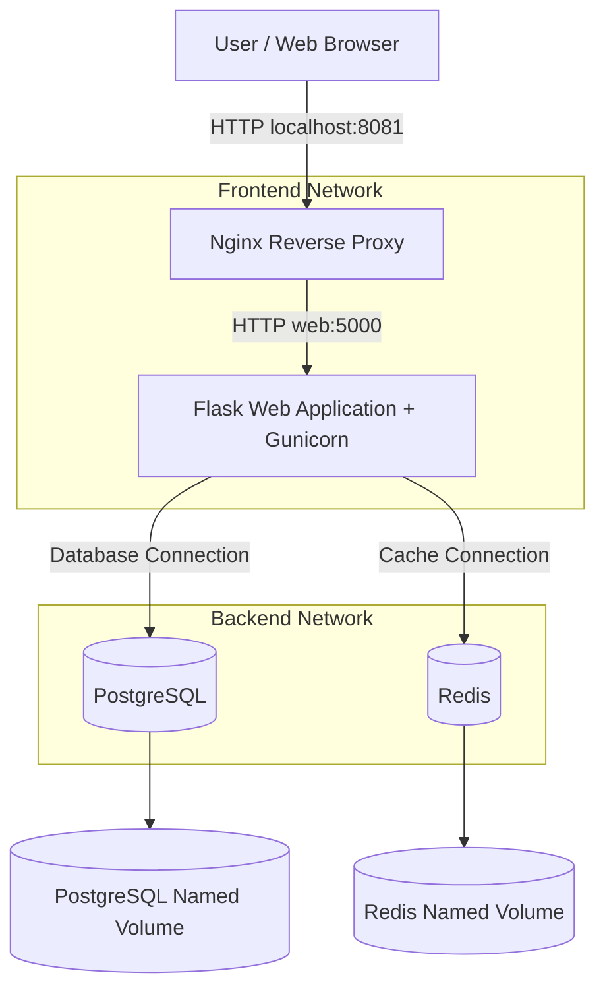

# ANALISIS ARSITEKTUR NEXUS CLOUD LAB

## 1. Gambaran Umum

NEXUS Cloud Lab merupakan aplikasi berbasis multi-container yang dibangun dan dikelola menggunakan Docker Compose.

Aplikasi ini dirancang dengan memisahkan setiap komponen ke dalam container berdasarkan fungsi dan tanggung jawab masing-masing. Pemisahan tersebut bertujuan untuk mempermudah pengelolaan layanan, komunikasi antarkontainer, penyimpanan data, serta pemeliharaan aplikasi.

Sistem terdiri dari empat service utama:

1. **Nginx:** Berfungsi sebagai Reverse Proxy yang menerima request dari pengguna dan meneruskannya ke aplikasi Web.
2. **Web Application:** Menggunakan Flask dan Gunicorn untuk menjalankan backend serta dashboard aplikasi.
3. **PostgreSQL:** Berfungsi sebagai database utama untuk menyimpan data aplikasi secara permanen.
4. **Redis:** Berfungsi sebagai cache untuk membantu mempercepat akses data.

Aplikasi dapat diakses melalui browser menggunakan alamat:

`http://localhost:8081`

## 2. Diagram Arsitektur

Diagram berikut menggambarkan hubungan antara pengguna, layanan aplikasi, jaringan Docker, dan penyimpanan data.

Arsitektur menggunakan pemisahan jaringan frontend dan backend untuk mengatur komunikasi antarkontainer sesuai dengan kebutuhan layanan.

## 3. Fungsi Setiap Service

### 3.1 Nginx Reverse Proxy

Nginx berfungsi sebagai pintu masuk utama aplikasi.

Fungsi Nginx meliputi:

- Menerima permintaan HTTP dari browser melalui port 8081 pada host.
- Meneruskan request ke Flask Web Application melalui alamat internal `web:5000`.
- Mengatur komunikasi antara pengguna dan backend aplikasi.
- Menjadi reverse proxy agar pengguna tidak perlu mengakses port backend secara langsung.

Nginx menggunakan image `nginx:1.27-alpine`.

### 3.2 Web Application

Web Application dibangun menggunakan Flask dan dijalankan melalui Gunicorn.

Fungsi Web Application meliputi:

- Memproses permintaan pengguna.
- Menyediakan halaman dashboard.
- Mengelola komunikasi dengan PostgreSQL dan Redis.
- Menyediakan endpoint API untuk pemeriksaan kesehatan aplikasi, catatan, dan statistik.
- Mengelola proses penyimpanan serta pengambilan data.

Web Application menggunakan image yang dibangun dari Dockerfile proyek.

### 3.3 PostgreSQL Database

PostgreSQL berfungsi sebagai database utama aplikasi.

Fungsi PostgreSQL meliputi:

- Menyimpan data catatan aplikasi.
- Mengelola operasi penyimpanan dan pengambilan data.
- Menjaga data tetap tersedia melalui named volume.
- Menjadi sumber data utama aplikasi.

PostgreSQL menggunakan image `postgres:16-alpine`.

### 3.4 Redis Cache

Redis berfungsi sebagai penyimpanan cache sementara.

Fungsi Redis meliputi:

- Menyimpan cache daftar catatan.
- Mempercepat akses terhadap data yang sering diminta.
- Mengurangi pengambilan data berulang dari PostgreSQL.
- Menggunakan TTL 30 detik untuk masa berlaku cache.
- Mendukung mekanisme Cache MISS, Cache HIT, dan Cache Invalidation.

Redis menggunakan image `redis:7-alpine`.

Redis bukan sumber penyimpanan data permanen aplikasi. PostgreSQL tetap menjadi sumber data utama.

## 4. Arsitektur Dashboard Aplikasi

NEXUS Cloud Lab memiliki dashboard modern dengan sistem navigasi multi-halaman.

Dashboard terdiri dari lima halaman utama:

| No. | Halaman | Route | Fungsi |
|---|---|---|---|
| 1 | Overview | `/` | Menampilkan ringkasan dashboard dan kondisi sistem |
| 2 | Services | `/services` | Menampilkan informasi layanan aplikasi |
| 3 | Database | `/database` | Menampilkan informasi dan pemantauan PostgreSQL |
| 4 | Cache Monitor | `/cache` | Menampilkan informasi Redis dan cache |
| 5 | Activity | `/activity` | Menampilkan informasi aktivitas aplikasi |

Seluruh halaman berjalan pada Flask Web Application dan diakses melalui Nginx Reverse Proxy.

Pemisahan halaman membantu pengguna mengakses informasi sistem secara lebih terstruktur melalui menu navigasi.

## 5. Jaringan dan Penyimpanan

### 5.1 Docker Network

Docker Compose menggunakan dua jaringan utama untuk mengatur komunikasi antarkontainer.

**A. Frontend Network**

Nama jaringan: `advanced_frontend`

Fungsi:

- Menghubungkan Nginx dengan Web Application.
- Memungkinkan Nginx meneruskan request ke backend.
- Memisahkan akses pengguna dari layanan database dan cache.

**B. Backend Network**

Nama jaringan: `advanced_backend`

Fungsi:

- Menghubungkan Web Application dengan PostgreSQL.
- Menghubungkan Web Application dengan Redis.
- Mengatur komunikasi internal layanan backend.
- Menggunakan konfigurasi internal agar jaringan backend tidak dipublikasikan secara langsung ke host.

### 5.2 Docker Volume

Proyek menggunakan named volume untuk menjaga persistensi data.

| Nama Volume | Mount Path | Fungsi |
|---|---|---|
| `advanced_postgres_data` | `/var/lib/postgresql/data` | Menyimpan data PostgreSQL |
| `advanced_redis_data` | `/data` | Menyimpan data Redis |

Named volume memungkinkan data tetap tersedia ketika container dihentikan, dihapus, dan dibuat kembali selama volume tidak ikut dihapus.

Dengan demikian, penyimpanan data tidak bergantung sepenuhnya pada siklus hidup container.

## 6. Alur Komunikasi Aplikasi

Alur komunikasi sistem berlangsung melalui beberapa tahapan:

1. Pengguna membuka aplikasi melalui browser dengan alamat `http://localhost:8081`.
2. Nginx menerima permintaan HTTP dari pengguna.
3. Nginx meneruskan permintaan ke Flask Web Application melalui service `web` pada port internal 5000.
4. Flask memproses permintaan berdasarkan route atau endpoint yang diakses.
5. Apabila membutuhkan data utama, Flask berkomunikasi dengan PostgreSQL melalui service `db`.
6. Apabila membutuhkan cache, Flask berkomunikasi dengan Redis melalui service `redis`.
7. PostgreSQL menyimpan data permanen, sedangkan Redis menangani penyimpanan cache sementara.
8. Hasil pemrosesan dikirim kembali kepada pengguna melalui Flask dan Nginx.

Alur tersebut memungkinkan setiap layanan bekerja sesuai tanggung jawabnya dan berkomunikasi melalui jaringan internal Docker Compose.

## 7. Mekanisme Persistensi dan Cache

### 7.1 Persistensi Data

PostgreSQL menggunakan named volume `advanced_postgres_data` untuk menyimpan data aplikasi.

Ketika container PostgreSQL dibuat ulang, data tetap tersedia selama named volume tidak dihapus.

Mekanisme ini dibuktikan melalui pengujian tantangan A, yaitu penghapusan dan pembuatan ulang container tanpa menghapus volume.

### 7.2 Mekanisme Cache Redis

Redis digunakan untuk menyimpan cache daftar catatan aplikasi dengan TTL 30 detik.

Mekanisme cache meliputi:

- **Cache MISS:** Data belum tersedia di cache sehingga aplikasi mengambil data dari sumber utama.
- **Cache HIT:** Data tersedia di cache sehingga dapat digunakan kembali.
- **Cache Invalidation:** Cache dihapus ketika terdapat perubahan data agar informasi terbaru dapat ditampilkan.

Penggunaan cache membantu mengurangi pengambilan data berulang dari PostgreSQL.

## 8. Keamanan dan Keandalan Sistem

Beberapa mekanisme diterapkan untuk mendukung keamanan dan keandalan aplikasi:

1. Pemisahan jaringan frontend dan backend.
2. Database dan Redis tidak memublikasikan port secara langsung ke host.
3. Penggunaan environment variable melalui file `.env`.
4. Penggunaan named volume untuk menjaga persistensi data.
5. Penggunaan healthcheck untuk memantau kondisi service.
6. Penggunaan kebijakan restart untuk membantu pemulihan container.
7. Penggunaan `depends_on` dengan kondisi `service_healthy` sesuai konfigurasi service.
8. Penggunaan Nginx sebagai reverse proxy untuk mengatur akses menuju backend.

Konfigurasi tersebut diterapkan untuk mendukung pengelolaan aplikasi dalam lingkungan praktikum berbasis Docker Compose.

## 9. Hasil Analisis dan Pengujian

Berdasarkan implementasi dan pengujian proyek, beberapa aspek yang telah diuji meliputi:

| No. | Aspek Pengujian | Hasil |
|---|---|---|
| 1 | Menjalankan empat service Docker Compose | Berhasil |
| 2 | Mengakses aplikasi melalui Nginx | Berhasil |
| 3 | Navigasi lima halaman dashboard | Berhasil |
| 4 | Komunikasi Web dengan PostgreSQL | Diuji |
| 5 | Komunikasi Web dengan Redis | Diuji |
| 6 | Cache MISS dan Cache HIT | Diuji |
| 7 | Cache Invalidation | Diuji |
| 8 | Persistensi data PostgreSQL (Tantangan A) | Berhasil |
| 9 | Penghentian service (Tantangan B) | Diuji |
| 10 | Kesalahan konfigurasi Nginx (Tantangan C) | Berhasil diperbaiki |
| 11 | Restart Resilience (Tantangan D) | Diuji |

Pengujian tantangan A–D telah dilaksanakan dalam proses praktikum dan didokumentasikan melalui bukti pengujian proyek.

## 10. Kesimpulan

Berdasarkan hasil implementasi dan analisis, NEXUS Cloud Lab berhasil menerapkan arsitektur aplikasi multi-container menggunakan Docker Compose dengan empat service utama, yaitu Flask Web Application, PostgreSQL, Redis, dan Nginx Reverse Proxy.

Sistem menggunakan Docker Network untuk mengatur komunikasi antarkontainer dan named volume untuk menjaga persistensi data. PostgreSQL berfungsi sebagai sumber data utama, sedangkan Redis digunakan untuk pengelolaan cache.

Aplikasi juga dilengkapi dashboard multi-halaman yang terdiri dari Overview, Services, Database, Cache Monitor, dan Activity. Seluruh halaman dapat diakses melalui Nginx Reverse Proxy pada alamat `http://localhost:8081`.

Pengujian mencakup komunikasi antarservice, persistensi data, mekanisme cache, penghentian service, kesalahan konfigurasi Nginx, serta restart resilience.

Dengan demikian, proyek ini menunjukkan penerapan konsep containerization, orkestrasi layanan, komunikasi jaringan, penyimpanan data, dan troubleshooting menggunakan Docker Compose dalam lingkungan praktikum.