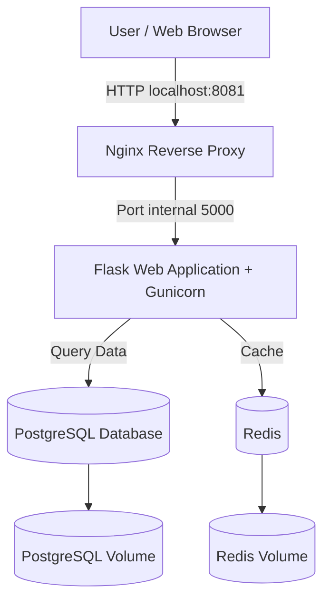

# ANALISIS ARSITEKTUR NEXUS CLOUD LAB

## 1. Gambaran Umum

NEXUS Cloud Lab merupakan aplikasi multi-container yang dikelola menggunakan Docker Compose.

Sistem terdiri dari empat service utama:
- Nginx sebagai reverse proxy.
- Flask dan Gunicorn sebagai Web Application.
- PostgreSQL sebagai database.
- Redis sebagai cache.

## 2. Diagram Arsitektur

## 3. Fungsi Setiap Service

### Nginx
Menerima permintaan HTTP dari pengguna melalui port 80 dan meneruskannya ke Web Application.

### Web Application
Menjalankan aplikasi Flask menggunakan Gunicorn, memproses permintaan pengguna, serta berkomunikasi dengan PostgreSQL dan Redis.

### PostgreSQL
Menyimpan data aplikasi secara permanen menggunakan named volume agar data tetap tersedia setelah container dibuat ulang.

### Redis
Menyimpan data cache sementara untuk membantu mempercepat akses aplikasi.

## 4. Jaringan dan Penyimpanan

Docker Compose menggunakan dua jaringan, yaitu frontend network dan backend network, untuk mengatur komunikasi antarkontainer.

Named volume PostgreSQL dan Redis digunakan untuk menyimpan data sehingga tidak bergantung pada siklus hidup container.

## 5. Alur Komunikasi Aplikasi

1. Pengguna membuka aplikasi melalui browser dengan alamat http://localhost:8081.
2. Nginx menerima permintaan HTTP.
3. Nginx meneruskan permintaan ke Flask Web Application.
4. Flask memproses permintaan dan berkomunikasi dengan PostgreSQL atau Redis sesuai kebutuhan.
5. PostgreSQL menyimpan data permanen, sedangkan Redis menangani data cache.
6. Hasil pemrosesan dikirim kembali kepada pengguna melalui Nginx.

## 6. Kesimpulan Praktikum

Berdasarkan hasil implementasi dan pengujian, proyek NEXUS Cloud Lab berhasil membangun sistem aplikasi berbasis Docker Compose yang terdiri dari empat service utama, yaitu Web Application menggunakan Flask dan Gunicorn, PostgreSQL sebagai database, Redis sebagai cache, serta Nginx sebagai reverse proxy.

Implementasi ini menerapkan Docker Network untuk komunikasi antarkontainer dan named volume untuk menjaga persistensi data. Pengujian menunjukkan bahwa aplikasi dapat diakses melalui Nginx, data PostgreSQL tetap tersimpan setelah container database dibuat ulang, serta Redis dapat menjalankan fungsi cache melalui mekanisme Cache MISS, Cache HIT, dan Cache Invalidation.

Selain itu, dilakukan pengujian gangguan service, kesalahan konfigurasi upstream Nginx, troubleshooting, dan restart resilience. Hasil pengujian menunjukkan bahwa sistem dapat dipulihkan setelah gangguan dan data tetap tersedia sesuai konfigurasi penyimpanannya.

Dengan demikian, praktikum ini memberikan pemahaman mengenai pembangunan, pengelolaan, komunikasi, penyimpanan data, dan troubleshooting aplikasi multi-container menggunakan Docker Compose.

